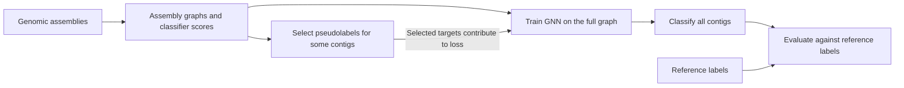
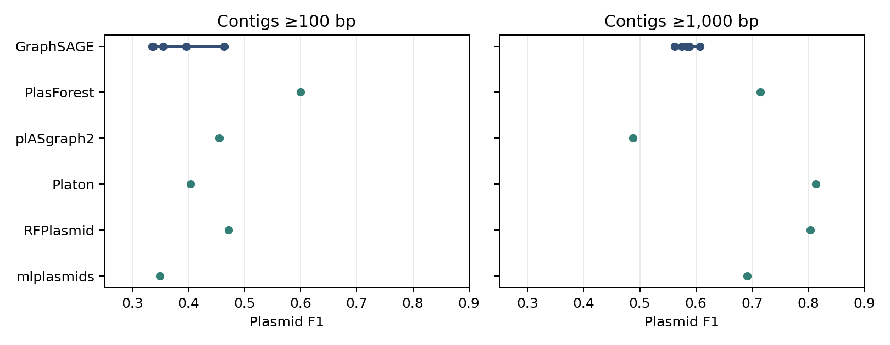

# GraSSPlas — Graph-Based Semi-Supervised Learning for Plasmid Classification

A short-read bacterial assembly contains fragments called **contigs**. Some come from plasmids, which are DNA molecules distinct from the main chromosome. A contig's sequence or classifier score can be inconclusive on its own. GraSSPlas asks whether a model can use assembly links and a limited set of training labels to classify contigs in the same collection of assemblies.

## How semi-supervised learning works here

A **pseudolabel** is a provisional training label produced by a rule or a tool. In the custom GraphSAGE experiment, matches to known plasmid markers can flag a contig as plasmid. A rule based on length and read depth, or how much sequencing coverage it has, can flag it as chromosome. The model trains on contigs with exactly one flag. Contigs with neither flag or both flags have no training target, but stay in the graph. Their classifier scores can still contribute to a linked contig's prediction. [GraphSAGE training labels and code](experiments/graphsage/README.md#dataset-and-training-labels)

The graph model sees all contigs and their links during training. The training loss, which measures prediction error and drives updates to the model, uses only selected targets. After training, the model predicts for every contig. Those predictions are compared with **reference labels**, also called ground truth. Training and evaluation use the same graph collection, including some of the same contigs. This setup is called **transductive evaluation**.



The diagram shows the custom GraphSAGE workflow. GNN stands for graph neural network. In the plASgraph2 true-label reference condition, a subset of evaluation labels is deliberately also provided as training targets.

## Two implementations

| Model | Inputs and outputs | Code used |
| --- | --- | --- |
| **Custom GraphSAGE** | Links from 52 *E. coli* assemblies and ten scores per contig from five classifiers. Produces one plasmid-or-chromosome call. | The PyTorch Geometric implementation is included. A single GraphSAGE layer combines each contig's scores with the scores of its incoming neighbors. |
| **Adapted plASgraph2** | Graphs from 51 isolates and nine scores per contig. Produces separate plasmid and chromosome scores, so a contig can be positive for both. | The TensorFlow/Spektral graph architecture comes from plASgraph2. The project compares different training targets and score inputs. This branch supplies the settings, launcher, scoring and analysis. Training and data preparation require the authorized adaptation. |

## Experiments

| Question | What was compared | Finding and interpretation |
| --- | --- | --- |
| **A. How well does the GraphSAGE pipeline classify plasmid contigs?** | Five saved GraphSAGE predictions and five classifier baselines, scored against the same reference labels at 100 bp and 1 kb. | GraphSAGE detected many plasmid contigs but made more false-positive calls. The strongest baseline had higher F1 at each cutoff. A matched comparison with graph links removed is unavailable. [Experiment A](experiments/graphsage/README.md) |
| **B. How do different training targets and feature inputs affect plASgraph2?** | MOB, MOB2, Pfam, feature masking, random labels and a true-label reference. | MOB2 had the highest mean F1 among the automatic strategies. The true-label reference scored higher with deliberate access to some evaluation labels. [Experiment B](experiments/weak-supervision/README.md) |
| **C. How repeatable is training on the same graphs?** | Repeated plASgraph2 fits under several seed settings, then intended fixes to the validation split and network dropout. | Variation persisted. At matching recorded seed 123, neither intervention consistently reduced the spread. The exact changes and other sources of randomness could not all be verified. [Experiment C](experiments/robustness/README.md) |

## Key results

**Precision** is the fraction of predicted plasmid contigs that match the reference. **Recall** is the fraction of reference plasmid contigs detected. **F1** combines precision and recall using their harmonic mean. **SD** is the sample standard deviation across fits. **bp** means base pairs, and **1 kb** is 1,000 base pairs.

| Comparison | Plasmid classification result |
| --- | --- |
| GraphSAGE vs strongest baseline at ≥100 bp | GraphSAGE F1 **0.3353–0.4640** across five saved fits. PlasForest F1 **0.6001**. |
| GraphSAGE vs strongest baseline at ≥1 kb | GraphSAGE F1 **0.5624–0.6068**. Platon F1 **0.8137**. |
| Six plASgraph2 conditions at ≥1 kb | MOB2 mean F1 **0.8597 ± 0.0146 SD**. True-label reference **0.9367 ± 0.0072 SD**. Each uses 25 fits. |
| MOB2 repeatability at ≥100 bp, recorded seed 123 | F1 SD **0.0372** for the reference, **0.0507** for the fixed-validation protocol and **0.1464** for fixed validation with network dropout disabled. Each uses five fits. |



The two pipelines use different cohorts and reference labels, so the F1 values cannot tell us which architecture is better. Neither evaluation estimates performance on unseen isolates. The 1 kb results score a length-filtered subset of the existing predictions.

## Install and verify

Run from the repository root. Python 3.8 or later is enough for the table checks and experiment summaries.

```sh
python3 -m unittest discover -s tests -p 'test_*.py'
python3 scripts/results.py validate
python3 scripts/results.py summary weak-supervision
python3 scripts/results.py summary robustness
```

GraphSAGE was tested on CPU with Python 3.8.10, PyTorch 1.13.1 and PyTorch Geometric 2.5.3. This example targets Linux x86-64 with a compatible CPU wheel.

```sh
python3.8 -m venv .venv
source .venv/bin/activate
python -m pip install 'torch==1.13.1+cpu' --extra-index-url https://download.pytorch.org/whl/cpu
python -m pip install -r experiments/graphsage/requirements.txt
python tests/smoke_graphsage.py
```

The smoke test runs one epoch on a four-contig synthetic graph. The GraphSAGE guide shows how to prepare the exact public input versions and launch training with the study settings. The plASgraph2 guides separate analysis of the included results from training, which requires external code and input tables. Exact historical retraining additionally depends on unavailable random states, source revisions or trained weights. [GraphSAGE commands](experiments/graphsage/README.md#how-to-run-or-verify) · [plASgraph2 commands](experiments/weak-supervision/README.md#how-to-run-or-verify) · [Repeatability analysis](experiments/robustness/README.md#how-to-run-or-verify)

## References and acknowledgments

- GraSSRep provided the original graph-based repeat-detection workflow. Hamilton, Ying and Leskovec proposed GraphSAGE. [GraSSRep](https://github.com/aliaaz99/GraSSRep) · [GraphSAGE paper](https://proceedings.neurips.cc/paper/2017/hash/5dd9db5e033da9c6fb5ba83c7a7ebea9-Abstract.html)
- Sielemann, Sielemann, Brejová, Vinař and Chauve developed plASgraph2. Mane and colleagues developed PLASEVAL, the source of the assembly data used in the study. [plASgraph2](https://doi.org/10.3389/fmicb.2023.1267695) · [PLASEVAL](https://doi.org/10.1186/s12859-024-05941-0)
- The research was conducted at Simon Fraser University with Cédric Chauve, Mahsa Feizrahnemoon and collaborators. The external tool authors and data contributors retain their respective attribution and terms.
