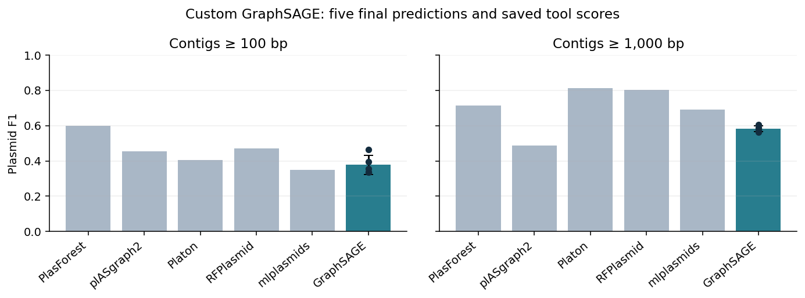

# Custom GraphSAGE experiments

The July prototype used two SAGEConv layers and a linear head over an eight-dimensional embedding. Its helper selected a training node when either pseudolabel was set. The August model uses one SAGEConv layer, a 16-dimensional hidden representation and a binary head. Its exclusive-or mask removes nodes with both labels and nodes with neither. The driver loads filtered GFA, tables and gold, then emits separate outputs for each array job.

The August code uses Adam at 0.001 for 2,001 epochs per fit. Each of five array tasks initializes ten models and writes only the last prediction vector. The final runs used the default random forest bypass. The optional forest fits on the pseudolabeled subset with 100 trees. The `embSize` argument remains in the August constructor and has no effect. `--noGNN 1` still trains the GNN for one epoch and bypasses embeddings for RF input. It cannot be interpreted as a completed graph-removal ablation.

## Data processing

The graph filter built an undirected graph from GFA segment and link records. For each short node, it connected pairs of neighboring extremities and removed that node. The saved filter outputs include the orientation fields inferred from those extremities. The separate August loader prefixes contig identifiers with the one-based manifest row number, keeping identically numbered contigs from different assemblies distinct. It reads features and pseudolabels from separate tables and concatenates them across samples. Gold is membership in the plasmid list. Every contig outside that list is scored as negative.

The ten features are the plasmid and chromosome score columns for five baseline classifiers. The alternative Pfam/MOB merge takes chromosome calls from the Pfam table and plasmid calls from the MOB table, joined by contig ID. It represents a separate prepared input, while the final array loader selects the `_060` tables. The public generator and BLAST reader preserve how the labels can be constructed. The historical command log and database versions remain incomplete. See [data provenance](../data/README.md).

## Implementation checks and limitations

| Issue | Historical behavior | Evidence and impact |
| --- | --- | --- |
| Softmax before cross entropy | The head applies softmax and feeds probabilities to `CrossEntropyLoss`, which expects raw logits and applies log-softmax internally. | The training objective and gradients differ from a standard logits-based loss. This branch preserves the objective used historically. A corrected loss would require a separately labeled experiment. |
| Positional table alignment | The pseudolabel and feature tables are filtered and concatenated independently. The label mask and class vector are applied in row order. | Rebuilding the 52 inputs reproduced identical feature and label ID order. The loader can silently misassign labels if a table is reordered. The preflight checks ID uniqueness and order and supports comparison to the saved tables. |
| Link orientation and graph layout | The GFA parser ignores the two orientation flags and overlap and retains one ordered pair per accepted record. It accepts only links whose retained segments have already appeared. | The verified graph has 25,347 edges, 125 self-loops and zero reciprocal non-self entries. Message passing depends on serialized direction. The undirected contraction step can collapse multiple links between the same nodes and writes `0M` overlaps. The effect of symmetric edges or different contraction rules was not measured. |

The full graph passes through GraphSAGE and batch normalization even though only masked nodes contribute to the loss. Full-graph scoring includes those nodes. The project did not demonstrate held-out isolate generalization.

## Evaluation and errors

The metric code calls plasmid when an external score is greater than 0.5. It computes pooled confusion matrices, precision, recall and F1 at 0, 100 and 1,000 bp. A 100 bp minimum was already applied to the model input, so the 0 and 100 bp rows share the same denominator. Intersection and union include all five classifiers and GraphSAGE.

| Run 1 at ≥1 kb | TP | FP | FN | TN | Precision | Recall |
| --- | ---: | ---: | ---: | ---: | ---: | ---: |
| GraphSAGE | 571 | 700 | 40 | 3129 | 0.4493 | 0.9345 |
| Platon | 428 | 13 | 183 | 3816 | 0.9705 | 0.7005 |

GraphSAGE had higher recall and many more false positives than Platon in this cohort. At 100 bp the best GraphSAGE fit had 1,438 true positives and 3,084 false positives. PlasForest had 1,341 true positives and 1,452 false positives. These aggregate counts support a precision–recall comparison. They do not identify a biological cause for individual errors. The older `output.csv` and `real_output.csv` generations have separate provenance and were excluded from the final result tables. See the [complete August metrics](../results/august_metrics.csv).

