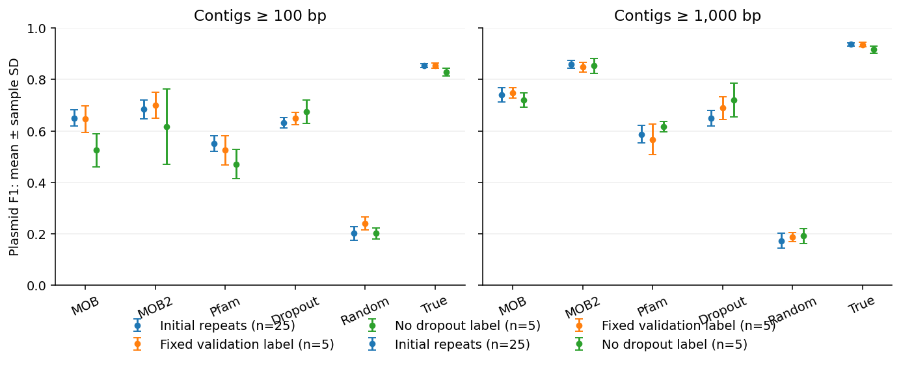

# Fall plASgraph2 experiments

The Fall experiments reused the TensorFlow/Spektral plASgraph2 graph model. The adaptation added nine external classifier features and compared alternative training targets or feature inputs. Its two sigmoid output scores represent chromosome and plasmid separately. A contig marked ambiguous can count positive for both. Unlabeled evaluation contigs are excluded.

| Condition | Training input or reference |
| --- | --- |
| MOB | MOB-recon plasmid calls and stricter Pfam chromosome calls |
| MOB2 | MOB recipe with the chromosome threshold reduced from 0.5 to 0.1 |
| Pfam | Pfam supervision for chromosome and plasmid |
| Feature dropout | Replaces external features with defaults for a fraction of pseudolabeled contigs, set to 20% in the experiment notes |
| Random-label control | Random class calls on a sample of roughly 10% of contigs |
| True-label reference | Known classes on a random subset of roughly 10% of contigs |

The six conditions compare within a common transductive cohort. The earlier August plASgraph2 sweep survives as pooled committed stats. The 52-isolate August GraphSAGE results come from a separate experiment. The Fall cohort has 51 isolates, 11,984 prediction rows per fit, 11,766 labeled contigs at 100 bp and 4,348 at 1 kb. For 116 common contigs the shared gold is chromosome-only while the custom pipeline calls plasmid-positive. Changes in features, model and gold prevent a controlled comparison across pipelines.

## Seed and intervention design

| Directory in the original lab checkout | Design | Saved fits |
| --- | --- | ---: |
| `Check_Randomness_Sep2024/` | Five nominal seed groups × five repeats × six conditions | 150 |
| `Find_Randomness_Source_Fix_Val_Set/` | Five repeats in the seed-123 folders, with the validation split held fixed according to the notes | 30 |
| `Find_Randomness_Source_No_Dropout/` | Five repeats in the seed-123 folders, with fixed validation and architectural dropout disabled according to the notes | 30 |

**33 of 210 saved configurations disagree with the seed in the folder name.** All 30 records assigned nominal seed 29 contain seed 20. MOB2 at nominal seed 13/run 4, Pfam at seed 37/run 2 and Random at seed 37/run 5 record seed 123. Those three have empty stdout transcripts. Their separate training and validation loss CSVs each contain 1,000 epoch entries. The configuration seed field records a value. It cannot establish which random number generators the historical code actually seeded.

Variability persisted in both diagnostic families. In the initial MOB2 series at 100 bp, the sample standard deviation in plasmid F1 was 0.0375. The fixed-validation family recorded 0.0507 and the no-dropout family recorded 0.1464, each based on five fits. These groups differ in run composition and source state. Their spread cannot identify a causal source of randomness. Feature dropout is an input condition, distinct from disabling dropout layers in the network.



## Run records and source recovery

The fit ledger maps each folder seed, repeat and condition to the saved seed, configuration profile and hash of the original YAML. The profile is a parsed record of the saved fields. It captures six tied graph layers, 32 graph channels, ten preprocessing channels, Adam at 0.005, a 100 bp floor and up to 1,000 epochs. Saved dropout fields cannot identify whether the dropout calls actually executed. The record explicitly retains the difference between settings stored in checkpoints and source described in the notes. See the [fit ledger](fits.csv) and [configuration profile](profiles.json) and [example seed-123 settings](example-seed123.yaml).

The lab scripts include `process-files.pl`, the training and evaluation launchers, `process_md.py` and family-specific `compare_seeds.py` files. The checksum catalog records their current recoverable copies and the three experiment notes. No distinct `Scripts_For_Randomness_Experiment/` directory was identified in the prior inventory or inspected experiment trees. The files that serve those roles were recovered from the experiment directories and their parent. See the [authorized local recovery guide](../../docs/reproduction.md#optional-local-preprocessing).

Use the sample-level scores only in an authorized environment. The public summary tooling groups the aggregate CSV by saved or folder seed.

```sh
python scripts/summarize_seeds.py --group-by saved_seed --threshold 100
```

See the [840 pooled metric rows](../../results/fall_metrics.csv), [Fall group summary](../../results/fall_summary.csv), [same-cohort comparator summaries](../../results/fall_baselines.csv), [earlier committed aggregate results](../../results/august_plasgraph2.csv) and [missing source evidence](../../docs/missing-evidence.md).
