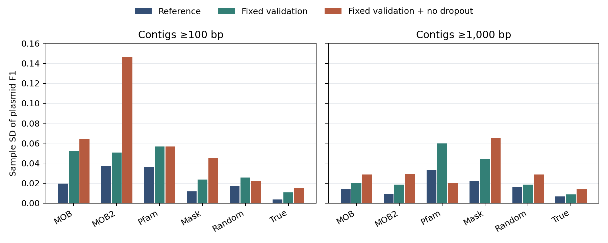

# Randomness and robustness

How variable are fits on the same graphs, and does fixing validation or disabling network dropout reduce that variability? This experiment repeats the [six plASgraph2 conditions](../weak-supervision/README.md#conditions) and uses the same cohort and pooled metrics.

## Protocols

| Protocol | Change from the reference | Fits |
| --- | --- | ---: |
| Multiple seeds and repeats | Five repeats per condition at nominal seeds 13, 20, 29, 37 and 123. This reference series also measures the effect of changing the nominal seed. | 150 |
| Fixed validation | The study protocol holds the training/validation split fixed and leaves other randomness active. Five repeats per condition use seed 123. | 30 |
| Fixed validation without dropout | Keep the fixed validation split and disable network dropout layers. The separate feature-masking input condition remains present. Five repeats per condition use seed 123. | 30 |

The [protocol definitions](protocols.json) record the repeat identifiers and seed groups. The reference fit rows live in the [weak-supervision results](../weak-supervision/results.csv). The [diagnostic results](results.csv) contain all 240 length-by-molecule rows for the 60 intervention fits. Both tables record the nominal and configured seeds per fit.

## Matched-seed comparison

The figure uses five fits per condition in each protocol at nominal and configured seed 123. Error summaries describe training variability on one reused cohort.



| MOB2 at seed 123 | Mean F1 ± SD ≥100 bp | Mean F1 ± SD ≥1 kb |
| --- | ---: | ---: |
| Reference | 0.6838 ± 0.0372 | 0.8462 ± 0.0090 |
| Fixed validation | 0.7004 ± 0.0507 | 0.8484 ± 0.0185 |
| Fixed validation without dropout | 0.6156 ± 0.1464 | 0.8539 ± 0.0293 |

Fixed validation had higher F1 variability for every condition at both cutoffs. With network dropout also disabled, only Pfam at 1 kb had lower variability than the reference. These observations do not establish the cause of the variation. Only five fits contribute to each comparison and the exact intervention code is unavailable.

## Reproduction

Run from the repository root. The default comparison uses seed 123. To inspect all runs grouped by recorded configuration seed, use the second command.

```sh
python scripts/results.py summary robustness
python scripts/results.py summary robustness --by-seed configured_seed
```

Of 210 fits, 33 have nominal and configured seeds that differ. All 30 nominal seed-29 fits recorded seed 20. MOB2 at 13/4, Pfam at 37/2 and Random at 37/5 recorded seed 123. The configurations alone cannot establish which code paths set individual random number generators. Those three runs have 1,000 training and validation loss entries each, while their training stdout is unavailable.

To run a new experiment, use the [weak-supervision launcher](../weak-supervision/README.md#execution-and-verification) with a corresponding authorized adaptation and distinct output directories. Exact intervention retraining is incomplete. The reference source revision `127692edfb821a1d6eff9aa081cf594b48e12ff3` is unavailable and the intervention changes were applied locally. Saved settings include a dropout value of 0.1 even for the no-dropout protocol. The source determines whether those layers execute. The aggregate measurements and matched-seed summaries remain independently checkable.
